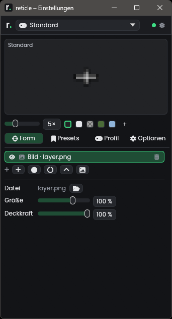

# reticle

Schlankes Crosshair-Overlay für Windows, in Rust. Läuft im Infobereich der Taskleiste und legt ein Fadenkreuz pixelgenau in die Bildschirmmitte. Das Spiel wird dabei nicht angefasst: kein Injizieren, kein Speicherlesen, keine Bildschirmauswertung.

**[Download: reticle.zip](https://github.com/7danee/reticle/releases/latest/download/reticle.zip)** · Windows 10/11 · keine Installation · [Änderungen](changelog.md)



- Ebenen: Kreuz, Punkt, Kreis, Chevron, eigene PNG/SVG
- Profile je Spiel mit automatischem Wechsel, Ausblenden beim Zielen
- Teilen per Code, Import von CS2- und Valorant-Codes
- Im Leerlauf 0 % CPU und unter 2 MB Speicher

> Nutzung in Online-Spielen auf eigenes Risiko: Kein Hersteller gibt eine offizielle Freigabe für Crosshair-Overlays. Siehe [Hinweise](#hinweise).

Stand: **v0.6.0**.

## Benutzung

1. `reticle.exe` starten. Das Crosshair erscheint in der Mitte des Hauptmonitors, im Infobereich taucht das „r.“-Symbol auf (grüner Punkt = Crosshair an, grauer Punkt = mit F8 ausgeblendet).
2. Spiel im **randlosen Fenstermodus** (Borderless / Windowed Fullscreen) starten. Über exklusivem Vollbild ist das Overlay nicht sichtbar.
3. **F8** blendet das Crosshair ein und aus.
4. **Linksklick** auf das Tray-Symbol öffnet die Einstellungen. Ein zweiter Start von `reticle.exe` tut dasselbe.
5. **Rechtsklick** öffnet das Menü: Einstellungen, Crosshair anzeigen, Im Stream verstecken, Config-Datei / -Ordner öffnen, Beenden.

### Einstellungen

Schmales Fenster (340×600): oben das Profil und die Vorschau, darunter vier Reiter (Form, Presets, Profil, Optionen); der Inhalt scrollt.

- **Profile:** „Standard“ gilt überall. Unter *Profil → Neues Profil* gibt es Vorlagen für Counter-Strike 2, Valorant, PUBG, GTA V, FiveM und ROB RUN oder ein eigenes Spiel. Ein Profil hat eigenes Crosshair, eigenen Versatz und eigenes Verhalten beim Zielen. Zugeordnet wird über den Programmnamen (z. B. `cs2.exe`, `*` als Platzhalter); „Laufende Programme“ listet, was gerade offen ist. Kommt das Spiel nach vorn, wechselt das Overlay automatisch.
- **Beim Zielen** (rechte Maustaste): immer zeigen, ausblenden solange gehalten, oder ein/aus je Klick.
- **Optionen:** Hotkey, Monitor („Automatisch“ folgt dem Monitor des Spiels; fester Monitor wählbar), „nur in Spielen mit Profil anzeigen“, Stream-Schutz, Autostart mit Windows, Design.
- **Ebenen:** Ein Crosshair besteht aus Ebenen (Kreuz, Punkt, Kreis, Chevron, Bild). Oben in der Liste = vorne. Jede Ebene lässt sich ein-/ausblenden, verschieben und löschen.
- **Eigenschaften:** Farbe (mit Deckkraft), Größen, Abstand, Kontur – je nach Ebenentyp. Die Regler decken den üblichen Bereich ab; durch Eintippen sind größere Werte möglich.
- **Bild:** PNG oder SVG wählen. Die Datei wird nach `%APPDATA%\reticle\images\` kopiert.
- **Vorschau:** Zoom bis 16-fach, verschiedene Hintergründe, Mitte markieren. Die Vorschau nutzt denselben Zeichencode wie das Overlay.
- **Presets:** Mitgelieferte und eigene Crosshairs. Klick übernimmt, eigene per Name speichern, Rechtsklick löscht.
- **Teilen** (im Reiter Presets): *Code kopieren* legt einen `rtcl1:`-Code in die Zwischenablage, ohne Server – einfach in Discord einfügen. *Code einfügen* nimmt reticle-Codes, Counter-Strike-Codes (`CS…` aus CS2 und alte `CSGO-…`) und Valorant-Codes (`0;P;…`). Spiel-Codes werden auf die Höhe deines Overlay-Monitors umgerechnet; bei alten CS:GO-Codes ist die Umrechnung eine Näherung. Bild-Ebenen bleiben lokal und werden nicht mitgeteilt. *Als PNG* speichert das Crosshair als Bild.

Jede Änderung landet sofort im Overlay, auch mitten im Spiel. Das Einstellungsfenster ist ein eigener Prozess und belegt nach dem Schließen keinen Speicher mehr.

## Config

Datei: `%APPDATA%\reticle\config.json`. Normalerweise schreibt sie das Einstellungsfenster; von Hand bearbeiten geht auch. Fehlende Felder bekommen ihren Standardwert, eine v0.1-Config wird automatisch übernommen. Ist die Datei fehlerhaft, bleibt das letzte gültige Crosshair aktiv und eine Windows-Benachrichtigung sagt, was nicht stimmt.

```json
{
  "toggle_hotkey": "F8",
  "monitor": null,
  "offset_x": 0,
  "offset_y": 0,
  "hide_from_capture": false,
  "only_in_games": false,
  "editor_theme": "dark",
  "aim": "off",
  "crosshair": {
    "layers": [
      { "type": "circle", "color": "#FFFFFF", "radius": 12, "thickness": 2 },
      { "type": "cross", "color": "#00FF66", "thickness": 2, "length": 6, "gap": 3, "t_style": false,
        "outline": { "enabled": true, "thickness": 1, "color": "#000000" } },
      { "type": "dot", "color": "#00FF66", "size": 2 }
    ]
  }
}
```

| Ebene | Felder |
|---|---|
| alle | `visible` |
| `cross` | `color`, `thickness` (1–32), `length` (0–200), `gap` (−50–100), `t_style`, `outline` |
| `dot` | `color`, `size` (1–32), `outline` |
| `circle` | `color`, `radius` (1–200), `thickness` (1–32), `outline` |
| `chevron` | `color`, `size` (2–100), `thickness` (1–16), `angle` (20–160°), `gap` (−50–100), `outline` |
| `image` | `file` (Name in `images\` oder absoluter Pfad, PNG/SVG), `scale` (0.05–8), `opacity` (0–1) |

`outline` = `{ "enabled", "thickness" (1–8), "color" }`. Farben als `#RRGGBB` oder mit Deckkraft `#RRGGBBAA`. Hotkeys z. B. `F8`, `Ctrl+Alt+H`, `Num5`, `Insert`; leer = kein Hotkey. Alle Größen sind echte Bildschirmpixel, unabhängig von der Windows-Skalierung.

`aim`: `off`, `hold` oder `toggle`. Die oberen Felder `offset_x`, `offset_y`, `aim` und `crosshair` gehören zum Profil „Standard“. Spielprofile stehen in `profiles`:

```json
"profiles": [
  { "name": "Counter-Strike 2", "programs": ["cs2.exe"], "offset_x": 0, "offset_y": 0, "aim": "hold",
    "crosshair": { "layers": [ { "type": "cross" } ] } }
]
```

Eigene Presets liegen in `%APPDATA%\reticle\presets.json`.

Zur Profilerkennung liest reticle nur den Programmnamen des Fensters im Vordergrund (dieselbe Abfrage wie der Task-Manager). Die rechte Maustaste wird nur mitgelesen, solange das aktive Profil „Beim Zielen“ nutzt.

## Leistung

- **Overlay im Hintergrund:** ein Thread, komplett ereignisgesteuert, kein Timer. Es wacht nur bei Tray-Klick, Hotkey, Fensterwechsel oder Änderung im Config-Ordner auf. Gemessen im Leerlauf: 0 ms CPU in 20 s, 1,8 MB privater Speicher. Gezeichnet wird nur, wenn sich das Crosshair ändert.
- **Beim Zielen:** Nur wenn das aktive Profil „Beim Zielen“ nutzt, wird die rechte Maustaste alle 15 ms abgefragt (statt jede Mausbewegung zu empfangen, was bei 1000–8000-Hz-Mäusen viel öfter wäre).
- **Einstellungsfenster:** zeichnet nur bei Eingaben, im Leerlauf 0 % CPU. Der Speicher (etwa 75 MB, größtenteils Grafiktreiber) ist nach dem Schließen wieder frei.
- **Allgemein für Overlays:** Jedes Fenster über einem randlosen Spiel lässt Windows das Bild zusammensetzen; bei manchen Spielen kann das minimal Latenz kosten. Das betrifft alle Overlay-Tools gleich. Das Overlay ist deshalb nur so groß wie das Crosshair selbst.

## Hinweise

- **Anticheat:** Ein externes Overlay ist der unauffälligste Weg, aber kein Hersteller gibt dafür eine offizielle Freigabe. Nutzung auf eigenes Risiko, besonders bei Valorant (Vanguard) und in Ligen.
- **SmartScreen:** Die .exe ist nicht signiert. Beim ersten Start „Weitere Informationen" → „Trotzdem ausführen".
- **Exklusives Vollbild:** Darüber ist kein Overlay sichtbar. reticle erkennt das und meldet es einmal je Spiel (abschaltbar unter Optionen → Vollbild). Im Spiel „Randloses Fenster“ einstellen.
- Overlay und Einstellungsfenster laufen jeweils nur einmal.

## Bauen

```bash
cargo build --release
```

Ergebnis: `target/release/reticle.exe` (eine Datei, keine Installation).

```bash
cargo test
```

Release-Zip (Tests, Build, `dist/reticle.zip` mit exe, Anleitung, Lizenz):

```bash
pwsh scripts/package.ps1
```

## Lizenz

reticle License: kostenlos nutzen, verändern und weitergeben, nicht verkaufen. Siehe [LICENSE](LICENSE). Schriften und Bibliotheken behalten ihre eigenen Lizenzen, siehe [notices.md](notices.md).
